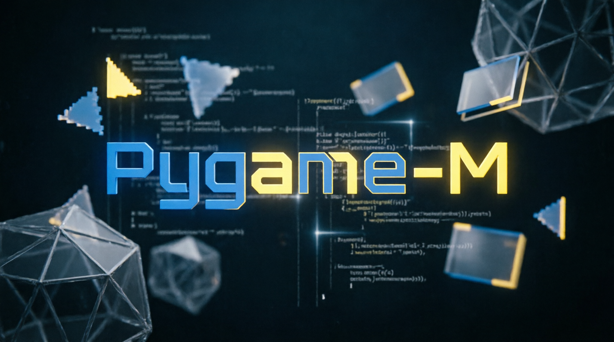

# pygame-M

<p align="center">
  
</p>

Base educativa para crear juegos con Python y
[Pygame Community Edition](https://pyga.me/).

## Empezar

Requiere Python 3.10 o superior.

```bash
python -m pip install -e .
python -m pygame_m
```

Se abrirá la pantalla de bienvenida. Presiona **Esc** para salir.

## Desarrollo

```bash
python -m unittest discover -s tests
```

Consulta la [guía de arquitectura](docs/arquitectura.md) para conocer la
estructura del proyecto.
